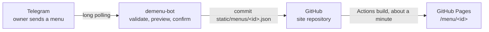

<p align="center"></p>

<h1 align="center">demenu-bot</h1>

<p align="center">
  <a href="https://github.com/luis-serrano-l/demenu-bot/actions/workflows/ci.yml"></a>
  <a href="LICENSE"></a>
</p>

A restaurant owner sends their menu to a Telegram bot and gets back a link
to a web page they can share with customers. The bot checks the menu,
shows a preview, and on confirmation commits it to the companion static
site, [luis-serrano-l/demenu](https://github.com/luis-serrano-l/demenu),
which GitHub Pages serves. There is no database and no public server: the
bot needs outbound HTTPS only, and the site repository is the source of
truth.



## Quick start

About five minutes, from nothing to a published menu. You need Docker, a
GitHub account and a Telegram account.

**1. Get a site to publish to.** Fork
[luis-serrano-l/demenu](https://github.com/luis-serrano-l/demenu). In your
fork open **Settings → Pages** and set **Source** to **GitHub Actions**,
then open the **Actions** tab, enable workflows, and run **Deploy Hugo site
to Pages** once. Your site is now at `https://<you>.github.io/demenu`.

**2. Create the bot.** In Telegram, talk to
[@BotFather](https://t.me/BotFather): send `/newbot`, choose a name and a
username, and copy the token it gives you.

**3. Create a GitHub token.** Go to
[github.com/settings/personal-access-tokens/new](https://github.com/settings/personal-access-tokens/new)
and create a **fine-grained** token with **Repository access → Only select
repositories →** your fork, and **Permissions → Repository → Contents:
Read and write**. Nothing else. Copy the token.

**4. Configure.**

```bash
git clone https://github.com/luis-serrano-l/demenu-bot.git
cd demenu-bot
cp .env.example .env
openssl rand -hex 32        # paste the output as HASH_SECRET
```

Edit `.env` and fill in the five required values:

```ini
TELEGRAM_BOT_TOKEN=<token from step 2>
HASH_SECRET=<output of openssl rand -hex 32>
GITHUB_TOKEN=<token from step 3>
GITHUB_REPO=<you>/demenu
HUGO_BASE_URL=https://<you>.github.io/demenu
```

**5. Start the bot.**

```bash
docker compose up --build --wait
```

The command returns when the container is healthy.

**6. Give yourself access.** Open your bot in Telegram and send `/myid`.
Put the number it replies with in `.env` as `ADMIN_USER_IDS=<number>`, then
apply it:

```bash
docker compose up -d --force-recreate --wait
```

**7. Publish.** Send `/template` to the bot. It sends you `menu.json`; send
that file straight back (or edit it first). The bot replies with a summary
and two buttons. Tap **Publish**, then **Open my menu**. The page is live
about a minute later, once the site has rebuilt.

Something not working? `docker compose logs bot` says why; see
[Run with Docker](docs/how-to/run-with-docker.md#troubleshooting).

## Using the bot

| Command | What it does |
|---|---|
| `/start` | What the bot does, with **Get a template** and **How it works** buttons |
| `/help` | The commands available to you |
| `/template` | Sends an example `menu.json` to edit and send back |
| `/link` | The link to your menu |
| `/status` | Your access, whether a menu is published, anything awaiting confirmation |
| `/delete` | Unpublishes your menu, after a confirmation button |

Send a menu as a `.json` file, as JSON pasted into a message, or as plain
text:

```
CATEGORY: Starters
- ITEM: Soup of the day
  PRICE: 5.00
  DESCRIPTION: Ask your waiter
```

Nothing is published until you tap **Publish**. If the menu has mistakes,
the bot names each field and how to fix it:

```
❌ Your menu has 1 problem:

1. categories[0].items[1].price
   missing price
   Fix: add a number, for example "price": 9.5
```

## Documentation

The [documentation](docs/README.md) follows [Diátaxis](https://diataxis.fr/):

| | |
|---|---|
| **Tutorial** | [Publish your first menu](docs/tutorial/first-menu.md) |
| **How-to guides** | [Run with Docker](docs/how-to/run-with-docker.md) · [Create the BotFather token](docs/how-to/create-botfather-token.md) · [Create the fine-grained GitHub token](docs/how-to/create-github-token.md) |
| **Reference** | [Environment variables](docs/reference/environment.md) · [Menu JSON schema](docs/reference/menu-schema.md) · [Commands](docs/reference/commands.md) |
| **Explanation** | [Design](docs/explanation/design.md) · [Threat model](docs/explanation/threat-model.md) |

## Roadmap

- **Webhook mode through a Cloudflare Tunnel**, as an alternative to long
  polling that still needs no open inbound port.
- **A snap package**, for running the bot without Docker.

## Contributing

See [CONTRIBUTING.md](CONTRIBUTING.md). To report a vulnerability, see
[SECURITY.md](SECURITY.md). Changes are recorded in
[CHANGELOG.md](CHANGELOG.md).

## Licence

[MIT](LICENSE)
