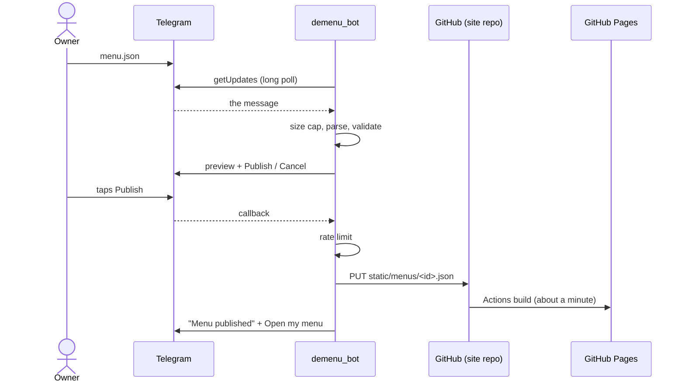

# Explanation: design

This page explains why the bot is built the way it is. For what it does,
see the [reference](../reference/commands.md); for what it defends
against, the [threat model](threat-model.md).

## The idea: a bot that commits files

A restaurant menu changes a few times a year and is read thousands of
times. That is the workload static sites are best at, so the bot does not
serve menus at all. It is a validating front door to a git repository:

What follows from that choice:

- **No database.** The site repository is the source of truth, with git
  history as the audit log: every publish and delete is a commit.
- **No public server.** Readers hit GitHub Pages. The bot can go down
  without a single menu going offline.
- **Nothing to scale.** Reading is a CDN's job.
- **About a minute of delay.** A publish is a commit, and the page appears
  when the site's build finishes. The bot says so rather than hiding it.

## Long polling, not webhooks

Telegram can deliver updates by calling a public HTTPS URL (a webhook) or
by letting the bot ask for them (long polling). The bot only polls.

A webhook needs a public address, a TLS certificate and an open inbound
port, and makes that port part of the attack surface. Polling needs
outbound HTTPS and nothing else, so the bot runs unchanged on a laptop, a
home server behind NAT or a small VPS, and the container publishes no
ports. The cost is that only one process may poll per token, which is fine
for a bot with this little traffic. A webhook mode behind a Cloudflare
Tunnel, which would keep the "no open port" property, is on the
[roadmap](../../README.md#roadmap).

## Preview, then confirm

Publishing replaces a public page, so it takes two steps: the bot shows
what it understood (categories, item counts, price range), and publishes
only when the owner taps **Publish**. The summary is the cheapest check
that the right file was sent: "Items: 3" when you expected forty is
obvious at a glance. `/delete` asks in the same way.

The pending action lives in the bot's memory, one per user, for 15
minutes. It is tied to its buttons by a random nonce, so a button works
once, only for its user, and never for a superseded preview. Keeping it in
memory means a restart forgets it; the user sends the menu again. That is
a deliberate trade against adding a database for a 15-minute value.

The rate limit is charged at **Publish**, not at upload. Fixing typos and
looking at previews is free; only commits to the site are metered.

## Errors written for the person who has to fix them

Menu authors are restaurant owners, not programmers. A reply such as
`json: cannot unmarshal string into Go struct field` is useless to them.
So the parser decodes JSON generically and walks it itself, which lets it
report every problem rather than the first, with an exact path
(`categories[0].items[2].price`), a plain statement of what is wrong and a
concrete fix. The bot shows five at a time: enough to make progress,
short enough to read on a phone.

The list format exists for the same audience: a menu can be typed into
the chat with no editor and no braces.

## Strict validation, canonical output

Whatever a user sends ends up in a public repository and on a public page,
so the bot accepts a small, fully specified document and rejects
everything else: unknown fields, oversized text, control characters,
image URLs that are not `https://` or site-relative. It then publishes its
own re-encoding of the parsed menu, never the user's bytes. The site can
therefore trust the shape of every file under `static/menus/`.

## Menu ids

A menu's address must be stable, must not reveal the owner's Telegram ID,
and should not be guessable from it. The id is base62 of the first 12
bytes of HMAC-SHA256(`HASH_SECRET`, user ID): 17 characters, the same on
every publish, and not reversible without the secret. One user has one
menu; that is the product, and it keeps the mapping trivial.

## Small pieces

Each concern is a small package with one job, wired together in
`main.go`:

| Package | Job |
|---|---|
| `internal/config` | Read and validate the environment; refuse to start on weak settings |
| `internal/bot` | Telegram client (long polling) and the conversation: commands, previews, buttons |
| `internal/menu` | Parse both formats, validate, summarise, encode |
| `internal/menuid` | Derive the public id |
| `internal/ratelimit` | Sliding-window limiter, in memory |
| `internal/publisher` | `Publisher` interface; `GitHub` implementation over the Contents API; `Fake` for tests |
| `internal/store` | Last published copy per user, on the data volume |
| `internal/redact` | Scrub secrets from all log output |

The handler talks to Telegram and GitHub through two small interfaces
(`Messenger`, `Publisher`), so the whole conversation, including every
button, is tested with fakes and no network.

## What it deliberately does not do

- Serve menus, images or any API. The only endpoint is `GET /health`.
- Host images. An item's `image` points at a file already on the site or
  at an `https://` URL.
- Keep drafts, history or several menus per user. Git has the history.
- Moderate content. Access is by allow-list; administrators decide whom
  to trust.
