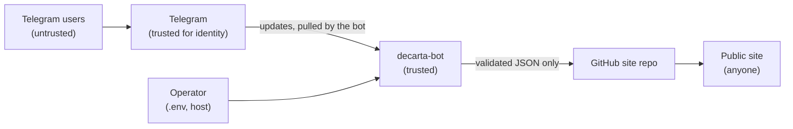

# Explanation: threat model

What the bot protects, from whom, and what it leaves to the operator. To
report a vulnerability, see [SECURITY.md](../../SECURITY.md).

## What is worth protecting

| Asset | Why it matters |
|---|---|
| The site repository and the public site | A menu page speaks for a restaurant. Unauthorised or malformed content is the main harm. |
| `GITHUB_TOKEN` | Can write to the site repository |
| `TELEGRAM_BOT_TOKEN` | Can read the bot's incoming messages and send messages as the bot |
| `HASH_SECRET` | Links Telegram user IDs to public menu ids |
| Telegram user IDs, usernames and names | Personal data of the bot's users |
| The bot's availability | Owners cannot update menus while it is down. Published menus are unaffected. |

Menus themselves are public by design and are not confidential.

## Trust boundaries

- **Telegram is trusted** to say who sent a message or pressed a button.
  The bot pulls updates over TLS from `api.telegram.org`; nobody can push
  updates to it, because it has no inbound endpoint for them.
- **Everything a user sends is untrusted**: message text, files, file
  names and sizes, and the data carried by buttons.
- **The operator and the host are trusted.** Whoever can read `.env` or
  the container's environment has every secret.

## Threats and what is done about them

### Someone without permission publishes or deletes a menu

- Publishing, `/template`, `/link` and `/delete` require the sender's ID
  to be in `ALLOWED_USER_IDS` or `ADMIN_USER_IDS`. The check is repeated
  when a button is pressed.
- A user can only ever write or delete their own file: the path is derived
  from the sender's ID, never from anything the user typed.
- Button data is `action:nonce`. The nonce is 72 random bits, stored per
  user, valid for one press and 15 minutes. Replaying another user's
  button, an old button, or a delete nonce as a publish does nothing.
- The bot ignores groups, channels and other bots, so a button cannot be
  pressed by a bystander in a shared chat.
- Malformed IDs in the access lists stop the bot at startup instead of
  being skipped, so a typo cannot silently change who has access.

### Hostile content reaches the site

- Size is capped before download (declared size), during download (bytes
  actually read) and for pasted text (`MAX_UPLOAD_BYTES`).
- The document is parsed strictly: unknown fields, wrong types and
  trailing data are rejected, and every string and list is bounded.
- Text may not contain control characters or text-direction overrides,
  which could make a page or a diff show something other than what was
  sent.
- `image` must be `https://` with a host and no credentials, or a
  site-relative path without `..`. `javascript:`, `data:` and `http:`
  URLs are rejected.
- The bot publishes its own encoding of the parsed menu, not the user's
  bytes, and only ever under `static/menus/<id>.json`, where the id is 17
  base62 characters. There is no path for a user to choose a file name.

The site must still escape what it renders; the bot guarantees shape and
size, not that a dish name is harmless HTML.

### A secret leaks

- All log output, including the Telegram library's, passes through a
  redactor that removes the configured secrets. Transport errors, which
  would include the token-bearing Bot API URL, are stripped of the URL
  first.
- Configuration errors name variables, never values.
- Users are logged only by menu id; raw Telegram IDs, chat IDs, usernames
  and names are not logged. The handler tests assert this.
- The GitHub token should be fine-grained: one repository, **Contents:
  Read and write**. If it leaks, the damage is limited to that
  repository's files, and git history shows what changed.
- Publisher errors shown to users are generic; details go to the log.

### Abuse and denial of service

- Uploads are limited per user (20 per 10 minutes), checked before
  anything is downloaded or parsed, so previews cannot be used to keep
  the bot busy.
- Publishes are limited per user (5 per hour by default) and
  `/request_access` notifications to once per user per hour, so a user
  cannot flood the repository with commits or the administrators with
  messages.
- Validation stops collecting after 50 problems, and replies are capped
  at Telegram's message size.
- At most 8 updates are handled at once; a panic in one is contained.
- The container is distroless and runs as non-root with a read-only root
  filesystem, no capabilities, `no-new-privileges`, and memory and PID
  limits. It publishes no ports.

### Menu ids reveal who owns a menu

The id is a truncated HMAC of the user ID under `HASH_SECRET`. Without
the secret it cannot be reversed or predicted. With the secret, anyone
can compute the id for any Telegram ID, so the secret must be at least 32
characters, has no default, and is treated like the tokens.

## What is not defended

- **A malicious publisher.** Anyone on the allow-list can publish any text
  that fits the schema, including offensive text or links in descriptions.
  Access is the control; `/delete` and `git revert` are the remedies.
- **A compromised host or operator account.** They hold every secret.
- **Telegram or GitHub themselves**, and the availability of either.
- **Rate limits across restarts.** Counters are in memory and reset when
  the bot restarts. The limit bounds abuse; it is not a quota system.
- **Revocation without a restart.** Access lists are read at startup.
- **Confidentiality of menus.** Anyone with the link, or the repository,
  can read them.
- **Enumeration of menus.** The site repository lists every published
  file. Ids hide who owns a menu, not that it exists.

## Operator checklist

- Use a fine-grained `GITHUB_TOKEN` limited to the site repository, with
  an expiry date. [How](../how-to/create-github-token.md).
- Generate `HASH_SECRET` with `openssl rand -hex 32` and back it up.
- Keep `.env` out of git and readable only by you (`chmod 600 .env`).
- Keep the allow-lists short, and restart after removing someone.
- Rotate the bot token with BotFather's `/revoke` if it may have leaked.
  [How](../how-to/create-botfather-token.md#rotate-it).
